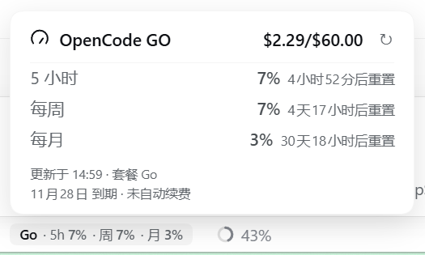

# dsh-opencode-go-usage

OpenCode GO 套餐用量显示插件，为 [DeepSeek Harness](https://github.com/deepseek-ai/deepseek-harness) Web GUI 而生。

在对话框输入框下方显示一个小药丸：`Go · 5h 7% · 周 7% · 月 3%`（`Go` 前缀 + 三个窗口，间距按自带统计栏压缩）。
点击后在指示条上方弹出详情卡片——头部是图标 + `OpenCode GO` + 本月已用 / 额度，单条分隔线下是
5 小时 / 每周 / 每月三行（百分比 + 重置倒计时），底部是更新时间、套餐名与到期 / 续费状态；
刷新按钮在卡片头部。配色、字号、行距与分隔线都对齐输入框自带的「Token 用量」统计弹层。



（截图左侧的「50M tok · 缓存命中 99%」与右侧的上下文用量是 DSH 输入框下方自带的统计，不属于本插件。）

## 数据来源

| 数据 | 来源 |
| --- | --- |
| 三窗口额度百分比、重置时间 | `GET https://opencode.ai/zen/go/v1/usage`（Bearer API Key，Host 侧请求） |
| 套餐名、计费周期、精确美元额度与已用 | `GET https://opencode.ai/console/api/go/status`（同一把 Key；micro-cent 金额，1 USD = 1e8）。这是内部接口，失败时自动退回下一条的估算 |
| 剩余美元估算 | 无 status 数据时按官方 [Go 用量说明](https://opencode.ai/docs/go/)：5 小时窗口 = 月额度 20%，每周 = 50%，每月 = 100%；月额度默认 $60（Go 套餐），可在配置中改 |
| API Key | Harness 凭据服务里的 `OPENCODE_GO_API_KEY`（优先）→ 进程环境变量 → OpenCode 自己的 `auth.json` |

## 结构

```
index.js          Host 半：解析 Key、读取用量接口、注册同源 JSON 路由 /opencode-go-usage/api/state
client.js         Client 半：window.__ModuleLoader__ 懒加载工厂，注册到 conversation.composer.dock
cordis.patch.yml  bundle 插件行（dsh.bundle.patch 自动注入）
locale/           插件市场 / 设置页显示用的标题与描述（en / zh）
icon.svg          插件图标
```

Host 与 Client 之间只用一条同源 HTTP 路由通信，不依赖 Typert 代码生成，也不引入任何运行时依赖。

## 配置

安装后如需自定义，在 profile 的 `cordis.patch.yml` 用户层覆盖该行 `config`：

```yaml
- id: opencode-go-usage
  config:
    # 凭据名（环境变量 / 凭据服务里的名字）
    credential: OPENCODE_GO_API_KEY
    baseUrl: https://opencode.ai/zen/go/v1/usage
    # 缓存刷新间隔（毫秒）
    refreshMs: 60000
    timeoutMs: 15000
    # 套餐月额度（美元）：Go 是 60，Go Plus 是 40 的更高额度，按实际套餐改
    monthlyLimitUsd: 60
    # 也可以直接给三个窗口的额度（美元），优先生效
    # limits: { rolling: 12, weekly: 30, monthly: 60 }
    planLabel: Go
    debug: false
```

## 状态语义

| `error` | 含义 | 界面表现 |
| --- | --- | --- |
| `null` | 读取成功 | 显示三个窗口 |
| `no-key` | 没有找到 API Key | 整条隐藏（未使用 GO 的用户不受打扰） |
| `unauthorized` | Key 无效 / 被撤销 | 显示红色错误提示 |
| `no-subscription` | 账号未订阅 GO | 显示错误提示 |
| `network` | 连不上 opencode.ai | 保留上次快照并提示 |
| `bad-shape` / `bad-json` / `http-*` | 接口异常 | 显示错误提示 |

## 验证记录

在本机 DSH **0.2.1-rc.3** 实测（2026-10-28）：

- Host：`GET /opencode-go-usage/api/state` 返回 200，`keySource: "credentials"`，`sources: { usage: "ok", status: "ok" }`；`?refresh=1` 会真正重新拉取（`fetchedAt` 变化）。
- Client：`conversation.composer.dock` 槽位出现 occupant `opencode-go-usage`（active）；输入框下方一枚小药丸
  `Go · 5h 7% · 周 7% · 月 3%`（实测约 151×18 逻辑尺寸，比自带 Token 药丸更窄），鼠标移入 / 键盘聚焦时底色加深。
- 弹层锚定：按药丸的实测位置用 `position: fixed` 定位，**左边缘与药丸左边缘对齐**（实测左差 0px、垂直间距 11px），不占布局、不被 dock 行裁切。
- 详情卡片（无障碍树实测）：334×169 逻辑尺寸；头部 `14px/600` + 14px 分隔线；三行数据行距 25px（`padding 3px` + `line-height 18px`），
  标签用 `label-secondary`、数值用 `label-primary` 与 `label-secondary` 的 3:7 混色（对齐自带弹层的浅一档数值色）；
  底部更新 / 套餐 / 到期信息用 10.5px 次要色，且不再画第二条分隔线（与自带弹层一致，只有头部一条线）。
- 展示语言跟随页面语言（中文界面显示中文文案）；样式只使用 `--dsw-alias-*` 主题变量，暗色主题未单独截图验证。

## 已知限制

- 用量接口没有公开文档，官方可能调整；解析做了防御式处理，异常会显示为状态而不是崩溃。`/console/api/go/status` 是 Console 内部接口，失败时只影响精确美元与套餐信息，百分比照常显示。
- 百分比是账户级数据（含同一账号其他设备 / 客户端的用量）；同一把 Key 在凭据服务和 `auth.json` 里可能属于不同账号，插件优先使用 Harness 凭据服务（也就是 DSH 调用模型所用的那把 Key）。
- 三个窗口的百分比含义以官方说明为准。
